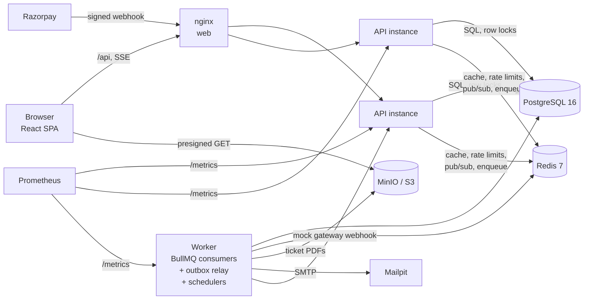
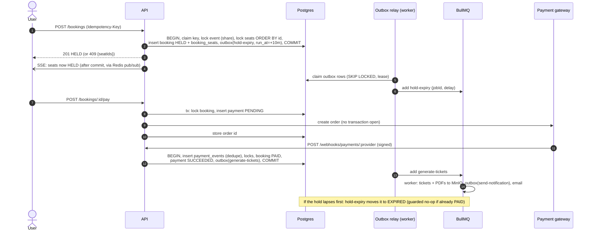
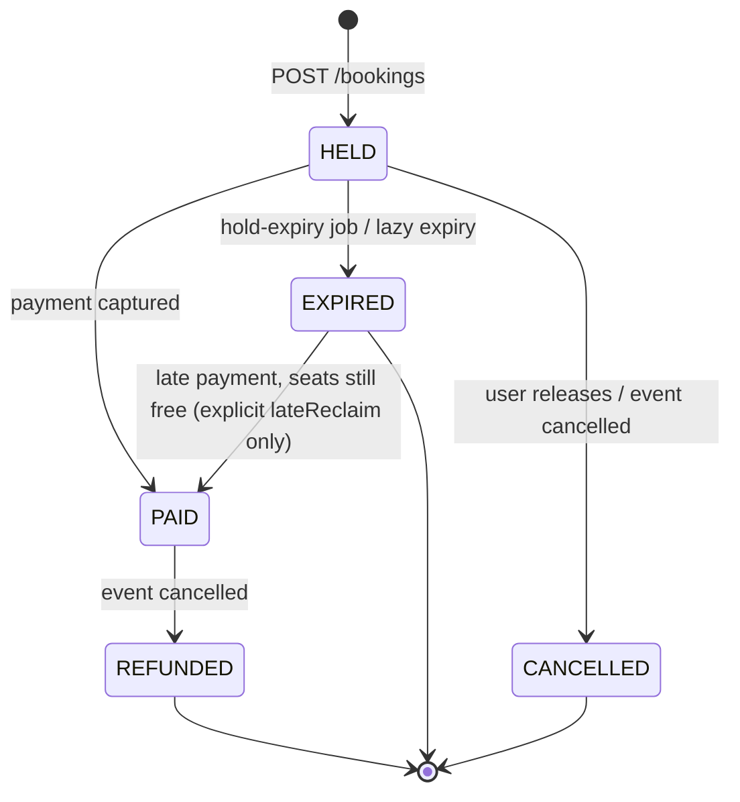

# TicketFlow architecture

Contents: [components](#components) · [booking flow](#booking-sequence) ·
[state machine](#booking-state-machine) · [core invariant](#the-core-invariant-one-active-booking-per-seat) ·
[outbox & jobs](#transactional-outbox) · [payments](#payments) · [tickets](#tickets-and-notifications) ·
[live seats](#live-seat-availability-sse) · [hardening](#caching-rate-limiting-metrics) ·
[lock order](#global-lock-order) · [failure modes](#failure-modes-and-how-each-is-handled)

## Components



The API (`src/server.ts`) and the worker (`src/worker.ts`) are two entrypoints into one
codebase, deployed from one image. They scale independently: the API with HTTP traffic,
the worker with job volume. Postgres is the source of truth. Redis holds only derived or
transient state (queues, cache, rate-limit counters, pub/sub), and the
[failure-mode table](#failure-modes-and-how-each-is-handled) shows what happens when it's gone.

## Booking sequence



## Layers

Each module under `apps/api/src/modules/<name>` follows the same structure:

| Layer | File | Responsibility |
|---|---|---|
| Route | `*.routes.ts` | Parse input with Zod, call one service function, shape the HTTP response. No business logic. |
| Service | `*.service.ts` | Business rules, authorization, transaction boundaries. |
| Repository | `*.repository.ts` | Raw SQL only. Functions that need row locks take a `TxClient`. |

`TxClient` is a branded type that only `withTransaction()` can produce. A function that
requires a `TxClient` (lock helpers, the booking state machine, `addToOutbox`) therefore
*cannot* be called outside a transaction. The compiler enforces this rule; it does not rely
on convention. `onCommit(tx, fn)` registers side effects (pub/sub, cache invalidation) that
run only after COMMIT, never on rollback, and after the connection is back in the pool.

## The core invariant: one active booking per seat

**Rule:** a seat may belong to at most one booking whose status is `HELD` or `PAID`.
History (expired, cancelled, refunded bookings) must stay in `booking_seats`.

### Approach chosen: denormalized `is_active` + partial unique index

```sql
CREATE UNIQUE INDEX booking_seats_one_active_per_seat
  ON booking_seats (event_id, seat_id)
  WHERE is_active;
```

`booking_seats.is_active` mirrors `bookings.status IN ('HELD','PAID')`. Only one function
writes it: `transitionBooking()` (`modules/bookings/booking-state.ts`). That function runs
in the same transaction as the status change, so the two values can never be observed out of
sync. New bookings insert their `booking_seats` rows with `is_active = true`.

**Why not reference `bookings.status` directly?** A partial index predicate can only use
columns of its own table.

**Why not an exclusion constraint?** `EXCLUDE USING gist (seat_id WITH =) WHERE (is_active)`
would also work, but it needs the `btree_gist` extension, and it is a GiST index doing what a
plain B-tree unique index does faster. With no ranges or overlaps involved, a unique partial
index is the simpler and faster tool. It also gives us a named constraint
(`23505` on `booking_seats_one_active_per_seat`) that is easy to assert on in tests.

**Why not a trigger that syncs `is_active` from `bookings.status`?** It would be equally
correct, but it hides a write that matters. Keeping it in the single transition function
keeps every state change explicit and testable in one place.

The index is the **backstop**. The normal path never reaches it, because seats are locked
and checked first (below). A raw SQL insert that bypasses the service is still rejected
(see `booking-state.test.ts`).

## `POST /bookings`: one transaction

```
BEGIN
 1. INSERT idempotency_keys (user_id, key, request_hash) ON CONFLICT DO NOTHING
      -> conflict: return the stored response (422 if the request hash differs)
 2. SELECT event ... FOR SHARE                    -- event can't be cancelled under us
 3. SELECT seats WHERE id = ANY($ids) ORDER BY id FOR UPDATE
 4. SELECT active booking_seats for those seats
      -> lapsed HELD holds: transitionBooking(EXPIRED) (lazy expiry)
      -> anything still active: 409 SEATS_UNAVAILABLE {seatIds}
 5. INSERT bookings (HELD, hold_expires_at = now() + 10 min)
    INSERT booking_seats (is_active = true)
 6. INSERT outbox (hold-expiry, job_id = hold-expiry_<booking>, run_at = hold_expires_at)
 7. UPDATE idempotency_keys SET status_code, response_body
COMMIT  -> after commit: publish seat states (SSE) + invalidate seat-map cache
```

### Deadlock freedom
Every transaction that locks seats locks them **in ascending `seat.id` order**, whatever
order the client sent. In the plan, `LockRows` sits above `Sort`, so `ORDER BY id FOR UPDATE`
acquires the locks in that order. When all lockers share one global order, no wait-for cycle
can form. Booking rows touched by lazy expiry are also locked in ascending id order, and
always *after* seat locks. The full order across all paths is in [Global lock order](#global-lock-order).

`booking-concurrency.test.ts` runs overlapping multi-seat requests in forward, reversed and
shuffled orders. It asserts there are no 5xx responses (a deadlock would surface as
`503 RETRYABLE_CONFLICT`). A control test shows that the same seats locked in opposite order
*without* the global order really do deadlock.

### Idempotency
- Keys are scoped per user: primary key `(user_id, key)`.
- The request hash covers the operation, the event and the **sorted** seat ids, so the same
  seats in a different order count as the same request. Reusing a key with a different
  request returns `422 IDEMPOTENCY_KEY_REUSED`.
- **Concurrent duplicates:** the second `INSERT` blocks on the first transaction's
  uncommitted key. After that transaction commits, the second one reads the stored response.
  If it rolled back, the second one proceeds as the original. Postgres serializes the
  duplicates for us, with no application-level lock.
- **What is stored:** committed outcomes. Those are `201` and `409 SEATS_UNAVAILABLE`, so a
  retried 409 replays as 409 even if the seat has since been freed. A new attempt needs a new
  key. Validation-type failures (unknown event, seats from another event) roll back the whole
  transaction, the key included, so the client can fix the request and retry with the same key.
- The web client generates one key per hold *attempt* and reuses it only when retrying after
  a network error, so a request that actually succeeded is replayed, not repeated.

### Lazy expiry
A `HELD` booking past `hold_expires_at` still owns its seats until something expires it:
normally the delayed `hold-expiry` job. The booking path also expires lapsed holds it
runs into (step 4), so a late or failed expiry job can never keep a seat unsellable.
For the same reason, the public seat map reports lapsed holds as `AVAILABLE`.
Timestamps are compared with Postgres `now()`, never the app clock, so clock skew between
the app and the DB cannot affect the result.

## Booking state machine



The normal table is exactly `HELD → PAID | EXPIRED | CANCELLED` and `PAID → REFUNDED`
(`canTransition`, asserted exhaustively in `booking-state.test.ts`). `EXPIRED → PAID` is
**not** in that table. `transitionBooking` allows it only when the caller passes
`{ lateReclaim: true }`, and only the payment-settlement path does, after locking the
seats and confirming they're free (see [late payments](#late-payments-the-race)).

`transitionBooking(tx, id, to, { guard?, lateReclaim? })` does the following:
1. locks the booking (`FOR UPDATE`);
2. if a `guard` is given and returns false, returns `{ applied: false }` without error.
   Idempotent callers such as expiry use this to mean "only if it is still HELD and lapsed";
3. otherwise validates the transition and throws `IllegalTransitionError` (HTTP 409) if it
   is not allowed;
4. updates the status and syncs `booking_seats.is_active`;
5. registers an after-commit hook that publishes the new seat states (live updates and
   cache invalidation). The hook never runs if the transaction rolls back.

## Transactional outbox

**Problem:** "commit the booking, then add the expiry job to Redis" loses the job if the
process dies between the two, and "add the job, then commit" creates phantom jobs on
rollback. Network I/O inside the transaction would hold row locks across a Redis
round-trip, and still not be atomic.

**Approach:** state changes write an `outbox` row **in the same transaction**
(`addToOutbox(tx, …)` requires a `TxClient`). The relay in the worker process moves rows
to BullMQ:

```
claim  : UPDATE outbox SET claimed_until = now()+30s, attempts = attempts+1
         WHERE id IN (SELECT id ... WHERE dispatched_at IS NULL
                        AND (claimed_until IS NULL OR claimed_until < now())
                      ORDER BY id LIMIT 100 FOR UPDATE SKIP LOCKED)     -- one short statement
enqueue: queue.add(name, payload, { jobId: row.job_id, delay: run_at - now() })   -- no tx open
mark   : UPDATE outbox SET dispatched_at = now() WHERE id = ANY(...)
```

- **Leases, not long-held row locks.** `SKIP LOCKED` makes concurrent relays (several worker
  replicas) claim disjoint rows. The lease means nothing is held open while talking to Redis.
- **Crash between commit and enqueue:** the row is still undispatched, and the next pass
  sends it. **Crash after enqueue but before marking:** the lease expires and the row is
  re-sent with the *same* deterministic `jobId` (`hold-expiry_<bookingId>`), so BullMQ
  keeps one job. Handlers are idempotent anyway.
- **Delays use the DB clock** (`run_at - now()` computed in SQL). A job that still fires
  early re-delays itself with `moveToDelayed` instead of burning an attempt.
- Failed dispatches back off exponentially (lease pushed out by `2^attempts` s, max 5 min).
  Dispatched rows are pruned after 72 h.
- Tests: `outbox-expiry.test.ts` simulates both crash points and checks that concurrent
  relays never double-claim.

### Queues

| Queue | Jobs | Concurrency / limit | Notes |
|---|---|---|---|
| `hold-expiry` | `hold-expiry` | 20 | delayed until `hold_expires_at` |
| `payments` | `refund`, `payment-reconciliation` (every 5 min) | 5, max 20/s | provider API calls |
| `mock-provider` | `deliver-webhook` | 10 | the mock gateway "calling back later" |
| `tickets` | `generate-tickets` | 4 | CPU-bound PDF rendering |
| `notifications` | `send-notification` | 5, max 10/s | SMTP rate limits |
| `reports` | `daily-sales-report-fanout` (00:30 UTC), `daily-sales-report` | 2 | fan-out: one job per organizer, id `sales-report_<org>_<date>` |
| `dlq` | `dead-letter` | none | parked for humans |

- One connection factory (`queues/connection.ts`) with three roles. Producers/cache use
  **fail-fast** (`enableOfflineQueue: false`, so callers degrade instead of hanging), workers
  use `maxRetriesPerRequest: null` (a BullMQ requirement for blocking commands), and the
  subscriber gets a dedicated pub/sub connection.
- Defaults: 6 attempts, exponential backoff from 1 s with ±50% jitter (spreads retry storms),
  completed jobs kept 24 h, failed jobs kept 7 d.
- Every payload is Zod-validated when written **and** when processed (Redis is external
  input). An invalid payload throws `UnrecoverableError`, so it fails once instead of retrying.
- **Dead letters:** when a job fails for the last time (attempts exhausted or unrecoverable),
  the worker copies it (queue, name, id, data, reason) to the `dlq` queue.
  `GET /admin/dlq` lists entries and `POST /admin/dlq/:id/retry` re-validates and re-enqueues
  under a fresh id.
- **Graceful shutdown:** on SIGTERM the worker stops the relay, then `Worker.close()` waits
  for in-flight jobs (compose gives it 35 s). A worker killed mid-job leaves the job's lock
  to expire. BullMQ's stalled-job check re-delivers it, and the idempotent handler finishes it.
- **Bull Board** at `/admin/queues`. Admins `POST /admin/session` (bearer) to get a
  short-lived httpOnly cookie scoped to `/admin`, because the board's own XHRs can't send a
  bearer header.

## Payments

`PaymentProvider` (`modules/payments/providers/types.ts`): `createOrder`, `verifySignature`,
`parseEvent`, `fetchOrderStatus`, `refund`.

- **MockProvider** (default): a fake gateway that misbehaves like real ones. Orders live in
  Redis (shared by API and worker). A delayed `deliver-webhook` job settles the order once
  and POSTs an HMAC-signed webhook. A retried delivery re-sends the **same event id**.
  Env switches produce duplicates (`MOCK_PAYMENT_DUPLICATES`), a stale `payment.failed`
  after the capture (`MOCK_PAYMENT_OUT_OF_ORDER`), dropped webhooks
  (`MOCK_PAYMENT_DROP_WEBHOOKS`, which reconciliation then fixes) and failures
  (`MOCK_PAYMENT_OUTCOME=failure`).
- **RazorpayProvider** (test mode): REST via `fetch` (no SDK), `x-razorpay-signature` HMAC
  over the raw body, and event id from `x-razorpay-event-id`. Assumes auto-capture. Razorpay
  has no idempotency header for refunds, so `refund()` first looks for an existing refund
  tagged with our key.

**Starting a payment** (`POST /bookings/:id/pay`): tx1 locks the booking and inserts a
`PENDING` payment (a partial unique index allows one per booking, so repeated clicks return
the same one). The provider order is created **between** transactions, then stored with a
guarded `UPDATE … WHERE provider_order_id IS NULL`. A crash in between leaves an order-less
`PENDING` payment, which the next "pay" click completes or reconciliation fails.

**Webhooks** (`POST /webhooks/payments/:provider`) are mounted before the JSON parser so
the signature is checked over the exact bytes. Responses: bad signature → `401`; event types
we ignore → `200 ignored`; unknown order → `503`, so the provider retries. That case covers
a webhook that beats our own "store order id" commit. The transaction rolls back, so the
event isn't marked as seen.

**Applying an outcome** is one transaction (`applyPaymentEvent`):
1. `INSERT INTO payment_events (provider, provider_event_id) … ON CONFLICT DO NOTHING`.
   Duplicates stop here, even concurrent ones: the second insert waits on the first
   transaction's uncommitted key, then conflicts.
2. A second layer of dedupe is the payment's own status. A capture applies only to a
   `PENDING`/`FAILED` payment, and a `failed` only to `PENDING`, so a stale `failed`
   arriving after the capture (out of order) is `already-settled`.
3. Locks follow the [global order](#global-lock-order): event (share) → seats → bookings → payment.

### Late payments (the race)

The money arrives after the hold expired and the expiry job already ran. Decision table
(`applyCapture`):

| Booking is… | Seats | Outcome |
|---|---|---|
| `HELD` (even if lapsed) | still owned by this booking | `PAID` |
| `EXPIRED`, event still on sale | all free (lapsed holds by others are expired on the spot) | **re-claim**: `EXPIRED → PAID` via `lateReclaim` |
| `EXPIRED` | anyone else holds/bought any of them | payment `REFUND_PENDING` (`SEATS_TAKEN`) + `refund` job |
| `EXPIRED`, event cancelled | n/a | refund (`EVENT_NOT_ACTIVE`) |
| `CANCELLED` / `REFUNDED` / `PAID` by another payment | n/a | refund (`BOOKING_CANCELLED`, `DUPLICATE_PAYMENT`, …) |
| any, amount ≠ order amount | n/a | refund (`AMOUNT_MISMATCH`), never applied |

**Why re-claim instead of always refunding:** the customer paid for those exact seats, and
nobody else wanted them in the meantime, so honouring the purchase is the better outcome
and avoids a refund. Re-claiming is safe because it runs under the same seat locks as a
new booking and re-checks availability. A competing booking either committed first (and the
check sees it) or is blocked on our seat locks. The partial unique index is the final
backstop. A partially available group (some seats free, some taken) is refunded in full:
we never sell someone half of a group booking.

**Reconciliation** (every 5 min): payments `PENDING` for more than 10 minutes are checked
with `fetchOrderStatus`, and the result goes through the **same** `applyPaymentEvent` with
a deterministic id (`reconcile:captured:<providerPaymentId>`), so a webhook that shows up
afterwards is a no-op. Payments whose order was never created are failed. Payments still
unresolved at the provider after 2 h are marked abandoned.

**Refunds** (`refund` job): the provider call happens outside any transaction, keyed by our
payment id. The `REFUND_PENDING → REFUNDED` flip is guarded, and the "refund issued" email
is written to the outbox in the same transaction.

**Event cancellation** releases bookings in the same transaction that cancels the event:
`HELD → CANCELLED`, `PAID → REFUNDED`, the payment goes to `REFUND_PENDING`, and an outbox
`refund` job is written. (Phase 1 refused to cancel events with active bookings; this
replaced that guard.)

## Tickets and notifications

- `generate-tickets` (written to the outbox when a booking becomes PAID): inserts one ticket
  per seat (`UNIQUE (booking_id, seat_id)`, `ON CONFLICT DO NOTHING`), renders each PDF in
  memory (pdfkit + qrcode), uploads it to a deterministic key `tickets/<booking>/<ticket>.pdf`
  (a PUT overwrites, so it's idempotent), and stores the key. A crash at any step resumes on
  retry. Then it outboxes `send-notification`.
- **QR token** `t1.<ticketId>.<HMAC-SHA256>`: forged codes are rejected before touching the DB.
- **Check-in** (`POST /tickets/verify`, organizer of that event or admin) is a single
  `UPDATE tickets … SET used_at = now() WHERE id = $1 AND used_at IS NULL AND booking PAID
  AND organizer matches RETURNING`. Under READ COMMITTED a concurrent scan blocks on the
  row and re-evaluates `used_at IS NULL` after the first commits, so exactly one scan
  admits. Failures are diagnosed read-only afterwards: already used / void (refunded) /
  not your event.
- **Downloads:** `GET /tickets/:id/download` returns a presigned MinIO URL (5 min, owner
  only). A separate presigning client uses the browser-reachable endpoint.
- **Email:** `send-notification` dedupes on a key in `notifications`. The send and the "sent"
  mark can't be atomic (SMTP isn't transactional), so a crash between them can send one
  duplicate email. That is at-least-once, by design.
- **Daily sales report:** a repeatable fan-out job enqueues one job per organizer. Each
  runs one aggregate query (payments that *succeeded* / were *refunded* that UTC day) and
  upserts `reports (organizer_id, report_date)`, so re-runs are idempotent.

## Live seat availability (SSE)

`GET /events/:id/seats/stream`. Every seat change publishes after commit to Redis channel
`seats:<eventId>`, from whichever process made it (API or worker). Each API instance holds
**one** subscriber connection. It subscribes to a channel only while it has clients for
that event, then fans out locally.

Gap-free snapshot on connect: **subscribe (buffering) → read snapshot → send snapshot →
flush buffer → live.** Messages carry absolute states (`{id, state}`), not deltas, so a
buffered message the snapshot already reflects is harmless to replay. EventSource
reconnects on its own (`retry: 3000`), and every reconnect starts with a fresh snapshot, so
a client that missed messages always resynchronizes. On shutdown the API closes streams so
clients reconnect to another instance. nginx disables buffering for the stream route.

The publish is **best-effort by design**: if Redis is down, the commit still stands and
clients resync on their next snapshot. Correctness lives in Postgres; the stream is UX.

Seat picker UX: selection is optimistic and local. A seat taken by someone else (seen via
the stream) is dropped from the selection with a notice. A `409 SEATS_UNAVAILABLE` keeps
the other picks, marks the conflicting seats immediately, and explains what happened.

## Caching, rate limiting, metrics

- **Seat-map cache** (`cache:seatmap:<eventId>`, 15 s TTL). Invalidated by every seat change,
  *before* the change is published, so a client reacting to the message never refetches a
  stale entry. A per-event generation counter closes the classic race (reader misses → reads
  DB → writer commits + invalidates → reader caches stale data): the write is a Lua
  compare-and-set on the generation. Any Redis error is treated as a miss. The cache is
  never consulted for correctness: booking always locks and re-checks seats in Postgres.
- **Rate limits** (Redis store, shared across instances): auth 20/min/IP. Booking and pay
  30/min per user (per IP if anonymous). If Redis is down they **fail open**
  (`passOnStoreError`). The booking path is protected by Postgres regardless, and locking
  everyone out during a Redis blip is worse.
- **Metrics** (`prom-client`): `http_request_duration_seconds{method,route,status}`
  (route template, bounded cardinality), `bookings_by_status`, `outbox_pending`,
  `queue_jobs{queue,state}`, `job_processing_duration_seconds`,
  `job_start_latency_seconds` (due → started), `jobs_dead_lettered_total`. The API serves
  `/metrics` (optionally behind `METRICS_TOKEN`); the worker serves `:9100/metrics`.
  `docker compose --profile observability up` adds Prometheus and a provisioned Grafana
  dashboard (`infra/grafana`).

## Global lock order

Every transaction that takes more than one of these locks takes them in this order:

```
event (FOR SHARE / FOR UPDATE)  ->  seats (ascending id)  ->  bookings (ascending id)  ->  payment
```

| Path | Locks |
|---|---|
| create booking | event share → seats → lapsed bookings |
| hold expiry / user cancel | booking |
| start payment | booking → payment |
| apply capture | (dedupe row) → event share → seats → bookings (own + lapsed claimants, sorted) → payment |
| apply failure / refund | payment |
| cancel event | event update → bookings (sorted) → payments |

No path acquires an earlier lock while holding a later one, so no wait-for cycle can form.

## Failure modes and how each is handled

| Failure | What could go wrong | How it's handled | Proven by |
|---|---|---|---|
| **Double booking** | Two buyers get the same seat | Seats locked `FOR UPDATE` in id order + availability re-check in one tx; unique partial index on active `booking_seats` as backstop | `booking-concurrency.test.ts` (50 → 1); k6 `contention.js` + `loadtest:verify` |
| **Deadlock** | Multi-seat requests in opposite orders | Global lock order (above); a 40P01 would surface as `503 RETRYABLE_CONFLICT` | concurrency test asserts zero 5xx; control test shows the deadlock without ordering |
| **Abandoned cart** | Seats held forever | Delayed `hold-expiry` job (via outbox), plus lazy expiry on the booking path, plus the seat map treats lapsed holds as available | `outbox-expiry.test.ts` |
| **Duplicate request** | A retry creates a second booking | Per-user `Idempotency-Key`, claim serialized by Postgres PK; stored response replayed | `bookings.test.ts` |
| **Duplicate webhook** | Payment applied twice | `payment_events` PK dedupe inside the applying tx + payment-status guard | `payments.test.ts` (10 concurrent → 1) |
| **Out-of-order webhook** | A stale `failed` undoes a capture | Outcomes apply only to `PENDING`/`FAILED` payments | `payments.test.ts`; mock `OUT_OF_ORDER` |
| **Forged webhook** | A fake "paid" | HMAC over raw body, constant-time compare, `401` | `payments.test.ts` |
| **Missed webhook** | Paid but booking stays HELD | `payment-reconciliation` every 5 min through the same apply path | `payments.test.ts` (drop + reconcile) |
| **Crash between commit and enqueue** | Job lost | Transactional outbox + leased relay; deterministic job ids dedupe re-sends | `outbox-expiry.test.ts` (both crash points) |
| **Late payment** | Paid after the hold expired | Re-claim if seats free, else refund job (decision table above) | `payments.test.ts` (both paths + lapsed rival) |
| **Worker crash mid-job** | Job half-done | BullMQ lock expiry → stalled job re-delivered; every handler idempotent (guards, `ON CONFLICT`, deterministic keys) | ticket-generation resume test; expiry/refund double-run tests |
| **Poison job** | Retries forever | Bounded attempts; `UnrecoverableError` for bad payloads → DLQ with reason; admin retry | `queues.redis.test.ts` |
| **Double check-in** | Ticket admitted twice | Single conditional `UPDATE … WHERE used_at IS NULL` | `tickets.test.ts` (20 concurrent → 1) |
| **Redis outage** | Queues / cache / pub-sub down | Bookings keep working (Postgres only). Outbox rows accumulate and drain on recovery, so no job is lost. Cache → misses; rate limits fail open; live updates pause and clients resync by snapshot on reconnect. Readiness reports Redis but only Postgres gates it. Payment start with the mock gateway fails (its order store is Redis) until Redis returns | design; outbox crash tests cover "enqueue failed" |
| **Postgres outage** | Everything | Readiness → 503 and the load balancer drains; no partial state (every change is one tx) | `/health/ready` |
| **Clock skew** | Early/late expiry | Hold comparisons use Postgres `now()`; delays computed in SQL; early jobs re-delay; the client countdown corrects with the server `Date` header | `outbox-expiry.test.ts` (not-due) |

## Auth
- Access tokens: HS256 JWTs (15 min), sent as `Authorization: Bearer`.
- Refresh tokens: 32 random bytes, stored as SHA-256 hashes, sent in an
  `httpOnly; SameSite=Strict` cookie scoped to `/auth`. Every refresh rotates the token.
  Presenting an already-rotated token is treated as theft and revokes the whole token
  family (every session derived from that login).
- Login compares against a dummy bcrypt hash for unknown emails, so response timing does not
  reveal whether an account exists.
- RBAC: `requireRole('organizer', 'admin')`. Ownership checks (an organizer may only manage
  their own events, or scan their own events' tickets) live in services.
- The SPA is served from the same origin as `/api` (nginx / Vite proxy), so the refresh
  cookie is first-party; the proxy rewrites its path to `/api/auth`.

## Conventions
- Money is integer paise (`integer` columns, `z.number().int()`).
- All timestamps are `timestamptz`, serialized as ISO-8601 UTC.
- Error body: `{ error: { code, message, details?, requestId } }`. The request id is also
  returned in the `x-request-id` header and appears on every log line.
